## 7/7 - introductions - 7 hours
we met each other, got a look at the course, and all drove the RC car through it one at a time. we also made accounts and signed up for Onshape and ChatGPT Plus, then Patrick showed us how to use Codex since that's how we'll be "coding" the entire project. 
another classmate and i then proceeded to spend the rest of the day setting up the Raspberry Pis that we're going to use as our robots' brains (we didn't finish that day)

attaached is a picture of that rc car
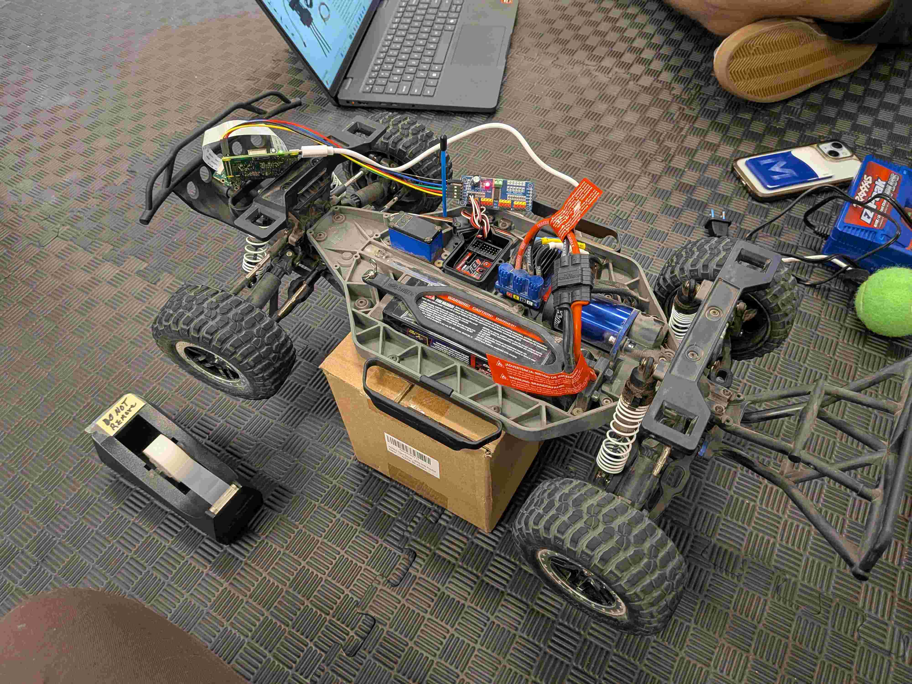

## 7/8 - setting up the Pi(s) - 7 hours
finished setting up the Pis (finally), despite the train of issues that tried to stop us: 
 - the first problem was that the college wifi required sign in, so setting it up headless wasnt working. 
 - i tried to use `lynx`, but the website required js on its sign-in page(??) so i couldnt do that. 
 - i tried to use my tether (basically a hotspot but without hotspot data) but `wpa_supplicant` wasn't authenticating properly. 
 - i tried to use my real hotspot, but the wifi didn't work with that either. on a whim i switched to 2.4GHz and WPA2 and it worked magically? 
 - of course rpi connect still didn't work and ssh wasn't allowed over my hotspot for some reason so i just had them buy us a monitor, reformatted with a desktop installed, and plugged in a usb mouse and keyboard to authenticate manually. 
 - of course ssh is blocked on the school wifi (what im using now), but rpi connect works enough.
that was pretty much the entire day though, the only other thing i did was getting a git repository set up on the pi

## 7/9 - ideas and groups - 7 hours
the start of the day was spent with all of us drawing our ideas for how we'd design a robot that could complete the course and then discussing what we drew, which was pretty helpful since i changed my design a few times based on what other people drew. i spent some time trying to get the IMX708 camera they bought to connect, which of course took **the entire day** 😭
the problem was that i was plugging it into port zero but the line in `/boot/firmware/config.txt` was `dtoverlay=imx708`. of *course* it was supposed to be include `cam0` to specify it was plugged into port 0 and not the apparent default of port 1(?!?).
but whatever, i got the camera plugged in and showing stills by the end of the day

## 7/10 - beginning on ball detection - 7 hours
one of my partners had already been working on a ball detection demo over the last couple of days that worked with their laptop camera, so i (Codex) took some time to add a picamera2 backend along with the existing opencv2 one and getting the code actually uploaded to the pi. there were a bunch of issues with libraries and venvs and maintaining stable input and output to and from the pi, but eventually we got some kind of a demo working. we had to plug in the pi's power supply in the corner of the room and partially covered by like 20 chairs, but the ball detection kind of almost maybe worked a bit! 
one problem was that they made the program assuming manual mouse input for initially cataloging the different colored balls under those lighting conditions, but that had to be removed because there was no good way to have mouse input and realtime monitor output for the pi *and we certainly wouldn't have that on the course itself)

## 7/13 - our real groups! and buyin stuff - 7 hours
we've finally formed our real groups! i got placed with two dudes, one my age and the other surprisingly young for the caliber of challenge we had ahead
we also got **$1000** to spend at our discretion for the next two weeks!!!!!!!!!🤑!!!!!!! we immediately made an amazon account and ordered some fundamental stuff, like:
1. a controller! i just bought a cheap usb xbox controller clone, since we dont really need quality but we *do* need a reliable connection that works on startup.
2. most importantly, motors!!!! this took a lot lot lot of deliberation (the whole day basically) and talking to our motors, but we eventually decided on these Maxynos planetary gear motors cause they have really good torque, theyre not too expensive, and we can easily buy some ESCs to connect to them. speaking off...
3. ESCs and power distribution cables: this constisted of the motor speed controllers that were very specifically bought for their XT60 plugs, and then 3 splitter cables (2 2-way and 1 3-way) to distribute the power to each of the 4 motors and the pi as well. 
4. battery: at the advice of Lucas, one of our mentors who clearly knows a lot about projects like this, recommended Spektrum smart batteries so we bought a few of those + a brand smart charger for both teams
5. 5V converter: to feed battery power to the Pi without literally kabooming it up (and to connect it in the first place).
6. tires: we spent a lot of time on this decision! once again, lucas came in clutch suggesting rc car crawlers wheels because they have a lot of friction but also are very bendy. plus they have listed dimensions and a lip to attach a "bead-locked" wheel to, so we can just design our own wheel and put it in once it arrives
and that was the day! whole lot of money spent for sure but its fineeeeeee (probably) *(hopefully)*

## 7/14 - figuring out the wheels - 7 hours
luckily the tires were able to arrive this morning, so Jade (one of the adults at the program) brought them in and we got to designing + 3d printing wheels for them! luckily we have full access to a bambu lab x1 carbon here, so we took some lessons from Carlos (one of the mentors) in Onshape and tried to design a preliminary wheel. of course it didnt fit cause we have no idea how to use calipers seemingly, but the second attempt actually worked pretty well! you could try to turn the tire and stop the wheel, and it wouldnt move unless you put a lot of force. we left a shaft hole in it ofc so we can put it on the motors when we recieve them tomorrow. very awesome very cool!!

## 7/15 - holy carp its actually driving (technically) *(barely)* - 7 hours
by that i mean we cut holes in a cardboard box, screwed the motors into them, stuck the wheels on, and codexed like no tomorrow until the motors somehow worked (THANK YOU SO MUCH LUCAS and also gpt luna), but our stupid dingy two-wheeled cardboard box actually moved! baby steps i swear
ok but more important we've actually designed a metal base for the robot!! its literally a flat metal sheet with holes cut in it + 2 bent sheet metal pieces with motor holes cut out in them but! we learned about onshape a bunch more, the process of sheet metal modeling, and especially how to work with a machine shop. you heard that right, we're getting our parts sent to a machine shop!!!! im really excited to see this piece come to life after we bumbled around on an onshape tab for like 3 hours trying to design it, i have a feeling its gonna be really cool. oh also were getting it tomorrow afternoon yay!!!!

attached is that slightly cooked "robot"
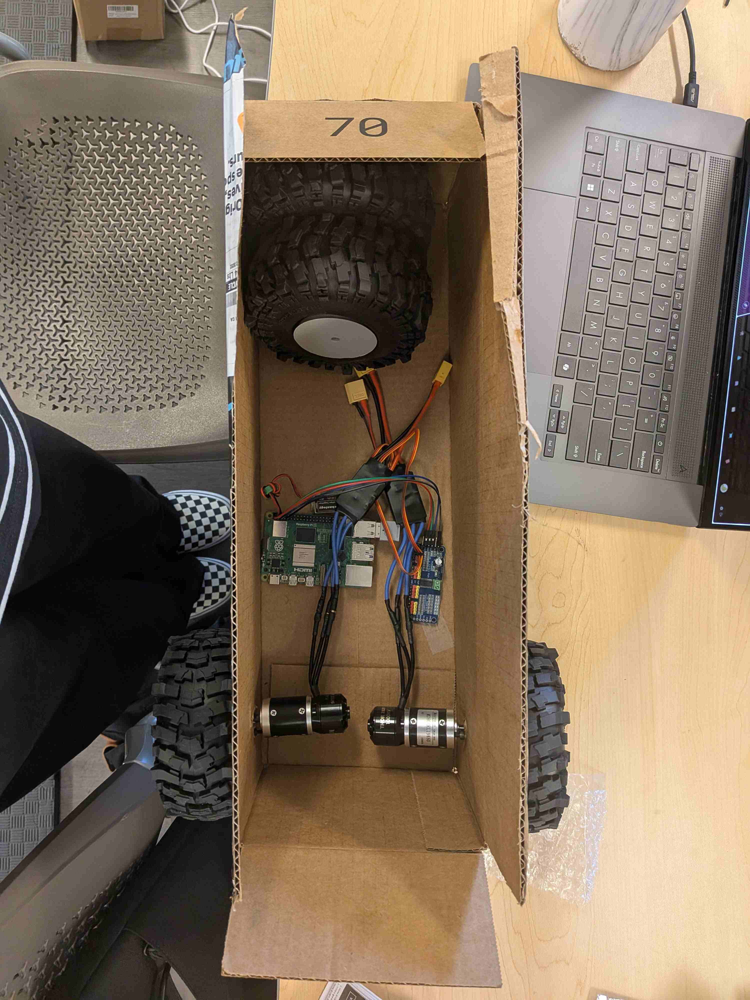

## 7/16 - the first assembly - 7 hours
ok sooooo turned out the wheels actually highkey sucked. the shaft was circular, so of course the motor didn't rotate it well (its a d-shaft motor so its shaft output has a chunk taken out of it), but even once we added the d-shaft it just turned the hole circular by itself anyways 😭
luckily Lucas told us about these things called shaft hubs that dig in to the shaft with set screws and provide screw holes perpendicular to the shaft that can be a lot better at transferring the rotational power without yknow slipping. so we bought those on amazon ofc!
but still the assembly went really well!! all the ports worked together, including the motor holes on the legs, and we were able to put the pi on top and connect all the electronics, eventually getting the motors actually moving while in the air by the end of the day! (with a lot lot of codexing ofc)

this is what the robot looks btw!! its super duper duper cool isnt it :3
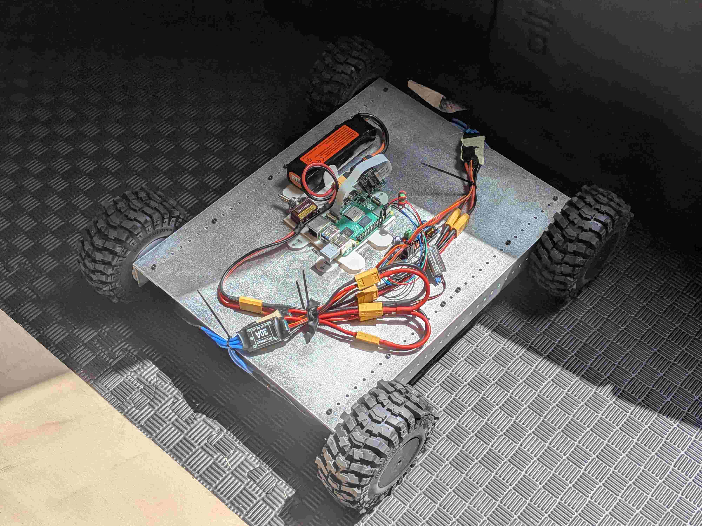

## 7/17 - code time yayyy - 7 hours
my day was spent entirely on programming two things:
**the controls** - i (codex) spent a bunch of time setting up: 
- the tank controls to individually drive each motor
- making the motor channels and configuration set in environment variables, and making a shell script that loads those environment variables from a shell script, enters the py venv, and runs the program
- adding different modes/states to the program and a radial menu to switch between them (all in a TUI by the way)
- adding a throttle limit and button presses to change it on the fly
- adding a button to start driving and making it so that every unrecognized button press stops it as a safety measure
it wasnt alllll codex tho, i came up with the all ideas for these and usually gave rather specific details for how i wanted them implemented

i also worked on the **ball detection**, which mostly involved sitting down and just adjusting parameters until the detection was like maybe almost passable, adding (asking codex to) add new parameters when the existing ones didn't encompass the mistaks the detector was making. needless to say this lowk took a while but we're in a good place rn i think!!! we have a moving robot with some kinda maybe working ball detection, which is like half of the first phase (the easiest part). so were slightly cooked but still yay it works!! 

## 7/20 - beginning on the suspension and new drive train - 7 hours
almost *all* of today was spent discussing and weighing different suspension designs and drive train implementations, culminating us in finally buying some parts and basically finishing out our $1000 budget from the start of the program to the end of this week. we settled on the 4 independent legs early, so the options were between:
 - mounting the motor on the chassis on the same pivot point as the leg itself
 - mounting the motor on the chassis and using a u-joint articulated axle
 - mounting the motor high up on the leg and using a belt drive
eventually we arrived on that last option because the other ones didnt really pose a benefit that was worth the complexity they would introduce (especially the first one)
towards the end of the day, we ordered all the parts we needed to install it hopefully over tomorrow and wednesday
also! we finished printing the finalized(...) wheel design so now we have four rigidly attached and bead-locked wheels+tires!! turns out the robot is like significantly faster than we thought so uhhh throttle limit is gonna have to be pretty low for a bit.

below is a sample of our mad drawings (mostly mine 😭) trying to figure out how the hell this thing is gonna work
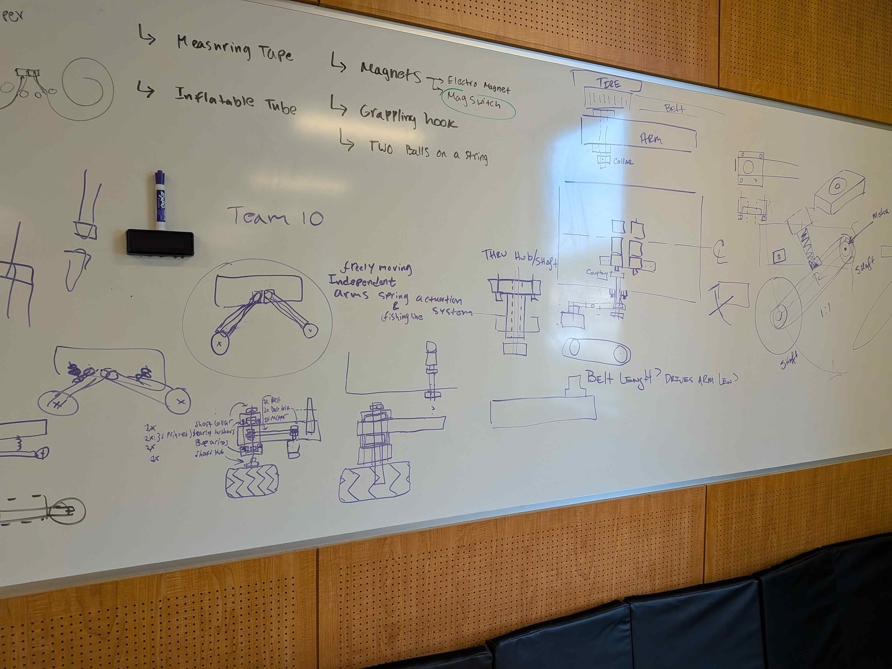

## 7/21 - EVERYTHING GOT DELAYED - 7 hours
VERY BAD NEWS: every single thing we needed to order for the drive train and suspension got delayed by a day 😭
anyways completely unrelated but the second competition is being moved to thursday, cause we cant drive through the course with literally 0 suspension

the first 2 hours of today was spent rushing out an onshape sketch to get our metal legs cut by Lucas cause he (reasonably enough) wanted the drawing by 11 before he left the shop. i had to remember how to do drawings, with a lottt of help from carlos. unfortunately, i forgot the holes for the spring on the top so we'll have to figure that eventually. i also forgot to put holes that would make screwing in the motor remotely possible but lucas the GOAT put those in for us. could not appreciate it more
we might be lowk cooked now, cause the bearings say they're gonna arrive thursday night so we may not even have the robot driving again until next week 😭😭
that being said we ball‼️

below are those legs with the motors screwed in since thats all we can really assemble rn
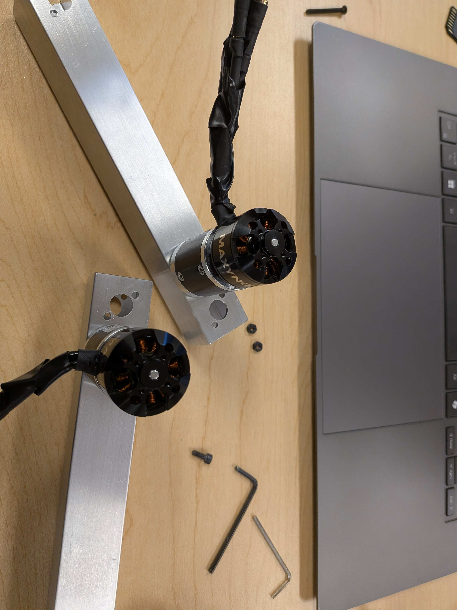

## 7/22 - not much we can do about it - 7 hours
much of today was spent moping about how everything would be arriving tonight (and of *course* the belts are arriving tomorrow night, one of the parts that is literally necessary to drive the thing at all). so much of today was spent just trying to design, cad, and otherwise figure out details for the legs before we actually had the components necessary to make them. i spent some time with one of my teammates figuring out where specifically the springs for the legs are gonna go, and he made a quick 3d printed rod-end that'll hold in the shaft that acts as the spring dowel. we also planned out where we could put the legs' pivot point on the chassis and just generally planned every element of assembly that we could. this also involved figuring out last second that i had no idea how we were gonna mount the springs and chassis on the leg at all and that my teammates didn't know too much either, but its cool we figured it out and started the print by the end of the day 👍

attached: us figuring out where we're gonna mount both the leg and the spring on the chassis and me drawing the top view of all the drive train stuff going on inside the leg (ignore my horrible handwriting its the board i swear)
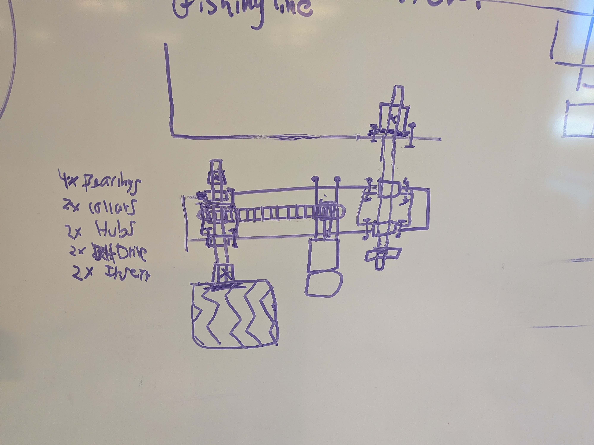

## 7/23 - YOU WOULD NOT BELIEVE WHAT JUST HAPPENED - 7 hours
guess what **THE BEARINGS AND SHAFTS GOT DELAYED!!!!** **YAAAAAAAAAAAYYYYY** its fine.
we spent today CADing and printing new designs for both the leg inserts and one piece of the rod-ends, and i think they're in a pretty good place (for not having the actual components needed). I also did some testing with the ball/cone detection and came to the conclusion that it simply sucks and just isn't good enough, so I got Codex to give me suggestions for an overhaul and I picked which approach would be the best to go for. The demo it produced for me using new shape detection and differentiating objects from its surroundings (in camera space) was *so* bad that I've decided on a completely different approach altogether: *ML!!*
I got it to do *another* overhaul that would add a mode to the existing code that allowed camera snapshots to be taken and put in a folder with a press of a button on the controller. Then, it made a tool that could be run on my laptop that would bring the images up one by one, I would mark balls and cones on there, and then that data would be used to train an ONNX model (with ROCM acceleration on my Radeon 890M iGPU, of course) that could then be uploaded onto the Pi and ran as the new detection backend!! we'll see if it works, cause I did all this at the end of the day and had no time to gather training data (of *course* i came up with this after two days of having very little to do). 

## 7/24 - assembly, finally! (+ a field trip) - 7 hours
the parts came! literally all of today was spent assembling the drive system as my partners were drilling the holes and cutting the shafts for the wheels, pivots, and spring dowels. we've unfortunately found out that the belt drives skip kind of a lot, so hopefully this doesn't cause issues with driving under torque when we get to that... (i swear if this is foreshadowing)
we also went out to Reflect Orbital today!! seeing the mirrors was incredibly cool, and the material they made it out of felt really interesting. something about its very small thickness (2.8 microns!!) made it feel like it was barely on your finger if you weren't looking at it. In addition, I talked to one of the software engineers (shoutout Alfonso) about how they get the software done, including things like:
- Double buffering updates (seemingly called ABing) to make sure that no update permanently breaks the system
- Using the Yocto project to make a custom Linux kernel for their embedded systems
- Monolithic applications vs. a more service based approach that also goes hand in hand with...
- Error handling and making sure that something like an illegal instruction won't crash your expensive space satellite
- Testing with the ground-sat (all of the components on the real satellite connected together on a table in a room) and an approach that involves uploading the changed code to the ground-sat every night and running a whole test suite to make sure none of the changes broke anything and that they (hopefully) achieved what they were written for
overall it was pretty damn cool you should check out [Reflect](https://reflectorbital.com) :3

below is one of the legs, and as you can see theres a whole belt going from the motor to the wheel!
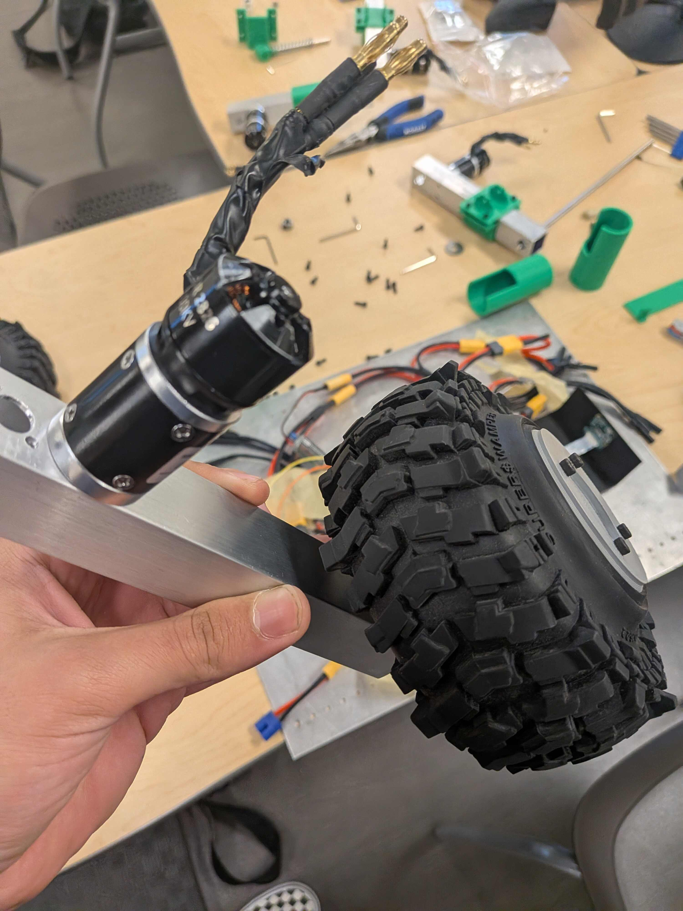
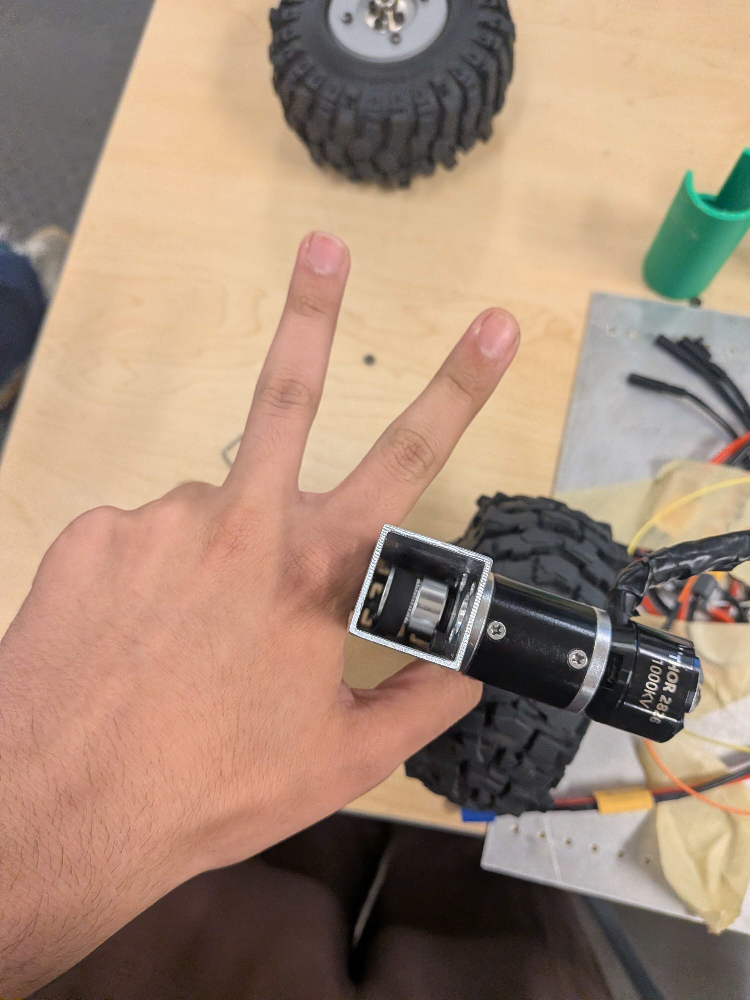

## 7/27 - the first suspension test - 7 hours
**GUESS WHAT!!!!!!!!!!!!!!!!!!!!!!!!!!!!!!!!!!!!!!!!!!!!** the belt is skipping. turns out the belt needs to be tensioned to not yknow skip horribly. any real torque that the wheel experiences back on it, including the torque inherently present in turning with tank drive (which is really high cause we have really grippy wheels and their laid out in a rectangle), makes the belt slip on the teeth and not drive the tire at all, leaving the motor spinning but the robot not moving. basically, we're gonna need a tensioner to slot into the legs.
in other news, we still have to get intake/outtake working by friday hopefully. i've ordered TPU filament online and got on of my teammates to start on a design for a flywheel that has a PLA hub and TPU tire, maybe we'll print it tomorrow?

although one good thing about this is that the robot looks super cool awesome now (source: see below)
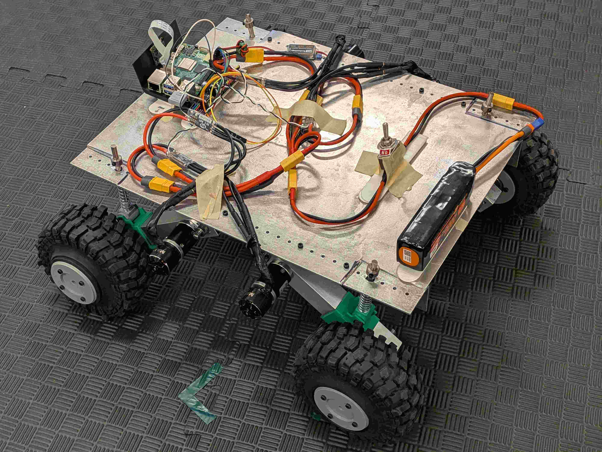
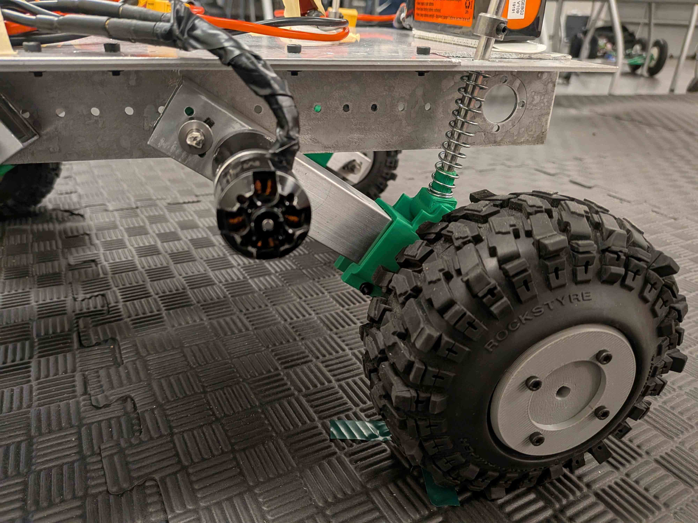

## 7/28 - we're lowk cooked.. - 7 hours
the TPU arrived! guess what though: it lowk doesnt work with the X1c (our printer)!!!!!!! we refined the design for the flywheel a bit, but after figuring out the TPU settings in the printer, our test prints didn't work at all. at some point, it just seems to run out of filament (usually before the first layer finishes) and leaves these dots of plastic where its supposed to be entirely filled in. no TPU ig!! 
my teammates spent most of the day figuring out where to cut holes for the tensioner and then actually drilling those holes for the eventual assembly (prob tomorrow). it looked really sucky cause the hacksaw is time-consuming and lowk rather annoying, especially when we need to cut 3 shafts into like 12 pieces, so thank you teammates that was very nice 🙏
i spent the whole rest of the day on the CAD for the articulated arms that we're gonna have in front and on top of the entire robot, and i designed a servo mount that'll keep the servos attached to the robot at the exact height we need them to be to make a plate that hits the ground, settles at a nice angle, holds the flywheels, and all the while still fits on the print bed. i tried to print one of those mounts but after like 5 prints that failed on the first layer, the only succesful print ran out of filament on the second to last layer 😭
its lowk chill though cause it looks kinda cool so im gonna keep it

attached is the lowk awesome lowk cooked servo mount that i lowk made and printed

lowk
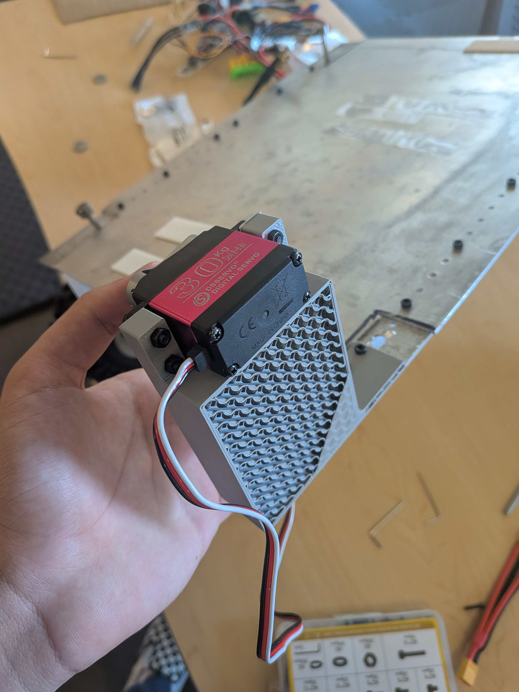

## 7/29 - adventures in TPU (AND A SPACEX TOUR YAYYYY) - 7 hours
so my GOATED teammate whose shall not be named figured out the TPU problem: the printer just wasnt strong enough to feed it in! i honestly have some doubt that that was THE problem, considering how easy the solution is (just unspool a bunch of filament onto the ground), but whatever we ball‼️
anyways the first third of today was spent working on that servo mount and arms CAD file i mentioned before as my partners finished up cutting the shafts and legs for the new tensioners. i also got the tensioners printed, but that was pretty quick since its just a few ~1x0.5" pieces
the second third was spent doing the assembly for all the pieces, since we had to take apart each leg completely, and then go down the assembly line to put it together. i was responsible for putting on the tensioners and then the motors with these really handy alligator clips Carlos graciously gave us that allowed me to get short screws into holes that were far into the leg. 
then, once the motor is attached, my partner would attach the wheel and get the belt on there. i think he used some like dark magic cause the belt was really hard to get on *before* it was tensioned, idek how he did it now...
my other partner would then put on the insert, bearings, and shaft for attaching the leg to the chassis. once we were done, we all spent some time getting the legs on the chassis but we didnt finish. i rushed to start the flywheel TPU print we designed a while ago before we left and spent the rest of the day on...
### THE SPACE X TOUR!!!!!!!!!!!!!!!!!!!!!!!!!!
we got to go to spacex and have a little tour with one of patricks friends!!!!!!!!!! it was really really really cool, the facility was huge and we such a bunch of fuel tanks, satellites, an engine actively being built, and a phased antenna array. that last thing nerdsniped me so hard, and because Simon (one of our "tour guides") was an engineer that worked on the Starlink user terminals (which also had the same type of antenna array as the Starlink satellites) i was able to ask a bunch of questions about it. apparently, they both have a bunch of antenna put together and arranged such that, by controlling the phase of the signal coming through each of the ~50 antennae, can focus on a narrow beam of EMF waves and effectively filter out signal to only a specific Starlink satellite in the sky. super cool!!!! 

no photo(s) cause we weren't allowed to take any but its chill

## 7/30 - the hill has finally been conquered... - 7 hours
I FORGOT TO PUT THE PRINT PLATE IN THE PRINTER YESTERDAY GOD DAMN IT 😭😭😭😭😭 its fine. ok so today was generally pretty mundane BUT!!! WE DROVE UP THE HILL LITERALLY ONCE!!!!! just on a whim my partner decided to go full power up the hill after my other partner had just loctited every set screw to see if we could make it, and we did!!!!!!!!!!!!!!!!!!!!!!
*.......unfortunately.........* nobody filmed it...................................
-# god damn it...............................
it was really cool though! i think it represents that we're really nearing a functionally useful robot and that were actually overcoming the challenges that have plagued us for like weeks

anyways heres a picture of our bot looking super duper cool
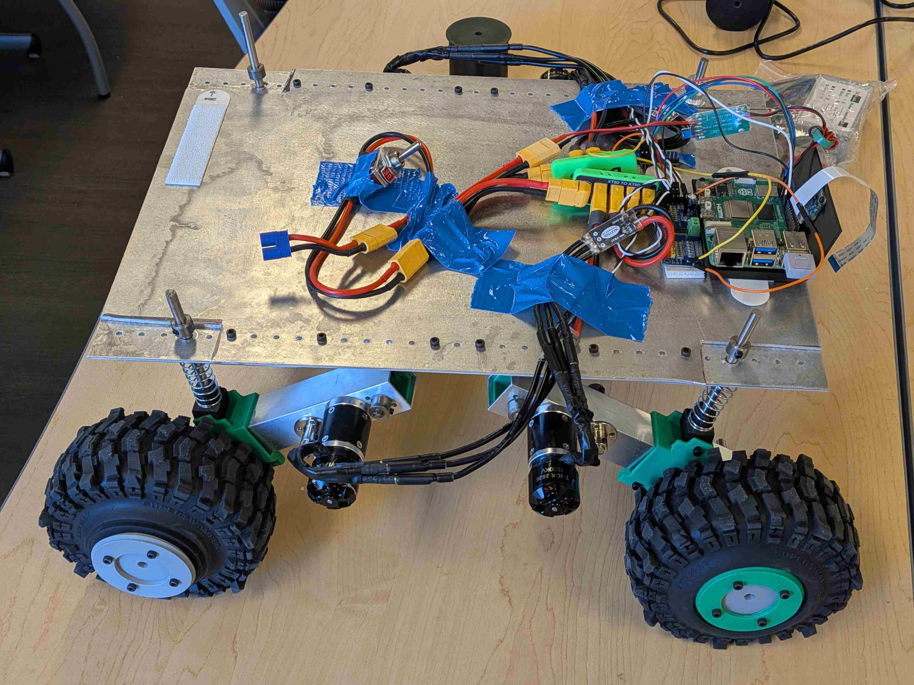

## 7/31 - the dreaded tokyo drift day - 7 hours
okay this day was an experience fs.
the start of the day was relatively normal, i was working a bit on ball detection while my partners assembled the intake/outtake thingy, and all of a sudden **the pi turns off**.
this happened before when the power draw was low and peripherals were connected, so i just took out the camera and turned it on. yup, works fine.
ok so lets plug the camera in while its on **and it turns off**.
odd, looks like its probably some random bug or connection issue, so i just unplugged it, reseated it, and restarted the Pi.
**and it doesnt even turn on.**
ok, well theres another port. idk whats going on, but maybe thatll fix it?
nothing. theres spare cables, lets try those ig?
nope. ok what the hell the camera must be broken, so lets try a spare camera.
**doesnt turn on.**
ok what the actual \*\*\*\*???? lets try it on *their* robot and then **theirs doesnt turn on either**.
at this point i am positively destroyed and fuming, luckily we have some very good food coming from a place nearby called the melt, so hopefully having a nice gooey cheesesteak can help me calm down, lock in, and figure out whats going on. **big mistake.**

*an hour passes. the adults have put on a movie, a fast and furious movie. you dont feel delirious, nor subdued, but simply off. its almost as if you are both more aware of your environment and slowly less aware of yourself.*
*an hour passes. the car noises are still going. focus was a lost cause. one adult is stretching on the floor. the other is sitting at a table, still watching. you're on the floor too. you're not getting anything done. it was a lost cause anyways.*
*an hour passes. carlos is sleeping on the slanted wooden plank of the hill. jade is lying on the floor and staring straight up. somehow your partner is locked in. the car noises continue. you are two inches away from meeting God, before you start laughing. shes laughing too, as well as your partner. presumably at carlos. sanity was a lost cause, and you lost it four and a half hours ago. cant believe its somehow 3:30.*

long story short, we slowly went insane with tokyo drift in the background as i pulled my hair out from the pi frying our cameras and the movie making it hard to focus, while one of my partners locked in to an unprecedented level, one just watched the movie casually, and the rest of us went crazy for no particular reason at all. this was a wild day (hence why im writing this the day after)
never eating at the melt again bruh 😭

## 8/3 - dawn of the final lock-in - 7 hours
i am gonna be gone wednesday, thursday, and friday this week due to my schools orientation happening right before CalTech's WiSTEM (which i am indeed going to :3), both of which are on weekdays. thus, with the intake challenge pushed *even further* to this wednesday (marking a full week delay), i will need to spend some time getting our existing systems to a good place and helping my partners with whatever they need over today and tomorrow before im gone. that being said, we did very little locking in today (hence calling it the dawn) because we had both a speaker and a tour!! 
Will Heltsley, former VP of Propulsion of SpaceX and an insanely knowledgable engineer, talked to us about different engineering concepts and some strategies for finding a stable job and a community of like-minded nerds that are fun to work beside. i asked a few questions about working with teams (because this program has shown me that it'll be a *very* valuable skill to learn), especially since Will has done everything from working on a 3-person team to managing a group of 350 engineers. he was really helpful!! 
we also got to tour another startup, Forge Atomics, and it was awesome to see the inner workings of a company that is just getting of the ground! they had a really cool concept and i loved their mission, which in talking to one of the co-founders (Rex the goat) i learned was one of the most important things in finding a team that is going to work well: your missions need to align. also i learned from both mentors that, unless you plan on doing something research heavy like quantum computing, you should NOT get a PhD. guess what i want to do!

## 8/4 - goodbye, bobot... - 7 hours
okay so like i said last entry ill be leaving for three days, which means that i had to finish up some things today! i decided at this point that we were not going to able to mount a plate in the front for the intake (rip that idea and the whole bunch of filament we wasted on it 😭) so i spent the entire day pivoting on that idea and making the articulated suspension!!!! this was a really cool idea i talked with carlos about for like an hour, although we were thinking about *only* servos for suspension. this time around, i modified those servo mounts to place the head of of the edge of the main plate and used a bit of kevlar string Trina donated (ty Trina!) and tied it to the servo head and around the wheels hub. this means that when the servo is drawn up, the string pulls on the wheel, compresses the spring, and brings the robot down.
for context, there is an 8 inch height requirement* that we had yet to succesfully get under. by that i mean the robot was like 11in. so, to get around that, these servo mounts could effectively deactivate the suspension at will, not only making driving more stable in the ball collection phase, but also actually getting under the height requirement! (since it was only a starting height requirement, we were allowed to expand after)
anyways i made one mount, tested it, it didnt fully work, designed another and printed two of them, codexed while that was printing, tested one (it worked perfectly), printed 2 more, codexed the code for different states and positions for the servos and configuration stuff ofc, assembled the rest, tested all 4 of them out at the same time, actually tied good knots, and it was done by the end of the day!! im really proud of finishing this subsytem in one day before i left, it was suprisingly fun to see the robot dancing and doing pushups as it drove. and honestly, i think today really gave me that feeling of how incredible it is to see something like this just come to life, the way i feel when i make progress on a good coding project. i lowk want a 3d printer now... maybe that radish jam money could really come in handy.......

## 8/10 - WERE BACK BOYS (gender neutral) - 7 hours
OKAY it is time to get down to business we do NOT have much time. first order of business was looking at the TPU wheels reflect printed! they had come in while i was gone, and compared to our flywheels they were actually suprisingly good (although they lowk had their heads blown shmoove off (the tops were weirdly disconnected and ripped off)). most of all, our wheels were much too stiff and theirs were relatively soft, so we decided to go with theirs. we'd also gotten metal parts back from lucas; unfortunately, lucas' parts were cut kinda incorrectly and for whatever reason the machine shop didn't make them!! so, i spent today primarily trying to figure out how to do intake while one partner was working on (OF COURSE) retightening and loctite-ing the set screws and the other partner was working on finishing/testing the climb with a smaller motor he bought online over my hiatus. and by figuring out the intake, i mean taping a cardboard box to the bottom of the robot and letting it flap down while desperately PRAYING that the balls go in. i was also driving around a bunch trying to figure out why the robot was still really struggling to take turns, especially on the foam. eventually i had the insight that the friction on the wheels was simply too much, and Lucas came up with the idea of wrapping tape around the wheels to reduce it!! after that it was insane how well it drove and took turns, especially off of the foam floor. i lowk drove it around for like 45 mins straight it was so insanely fun to see something we made acting like a real machine, cause it was driving at a quality i could actually expect in like a real product! it was so cool and gratifying :3
of course i forgot to get a picture of video of it, which i have a feeling im gonna regret...

## 8/11 - its officially frickmas eve... - 7 hours
and i call it frickmas cause THE COMPETITIONS TOMORROW OMG OMG OMG OMG
OK SO here's what on the agenda:
1. making sure the set screws dont destroy themselves on the field
2. getting the climb attached and making sure it maintains enough torque to actually pull the robot
3. figuring out some sort of system for intake
4. lining up all the suspension to prevent it from getting stuck, damaging the metal, or crapping out on the washboard section
5. making sure the pi mount, buck converter, code, suspension actuation, and every other subsystem actually work
6. testing!!! lots of testing of all of everything!!!!!!!
for the first one, my partner had already spent so long on the set screws so some testing was all it took to see that they were fine, and that was enough cause they were not really going to get any better.
my other partner finally got around to actually finishing up the climb and attaching it to the front of the bot. good news: it hooks! bad news: it doesn't even remotely pull back! luckily, the rules still gove points for hook but no lift, so we decided to leave it there since his effort could be best spent elsewhere with this little time left
the intake system was determined to be pretty much a dud by the end of the day, cause of course cardboard couldn't really carry anything, and we didn't have time to design something better since the last system fully failed
lining up the suspension was pretty easy, just took a bit of manual adjustment and a good amount of testing on the field
each of these were kind of annoying to address but i have a feeling itll be rather important at the end of the day (which is basically how long until handling all the wiring and subsystems took us)
lastly for the testing, we just drove like a bunch of times! honestly the runs went like okayish ig, we rarely made it past the washboard and of course NEVER made it over the hill ever since we did it first a couple weeks ago. otherwise though, the robot was stable the entire time and didnt have any weird glitches or hardware malfunctions (thank god we taped down the battery this time) so we were good(ish) to go!

below is basically what our final robot is gonna look like (minus the climb)
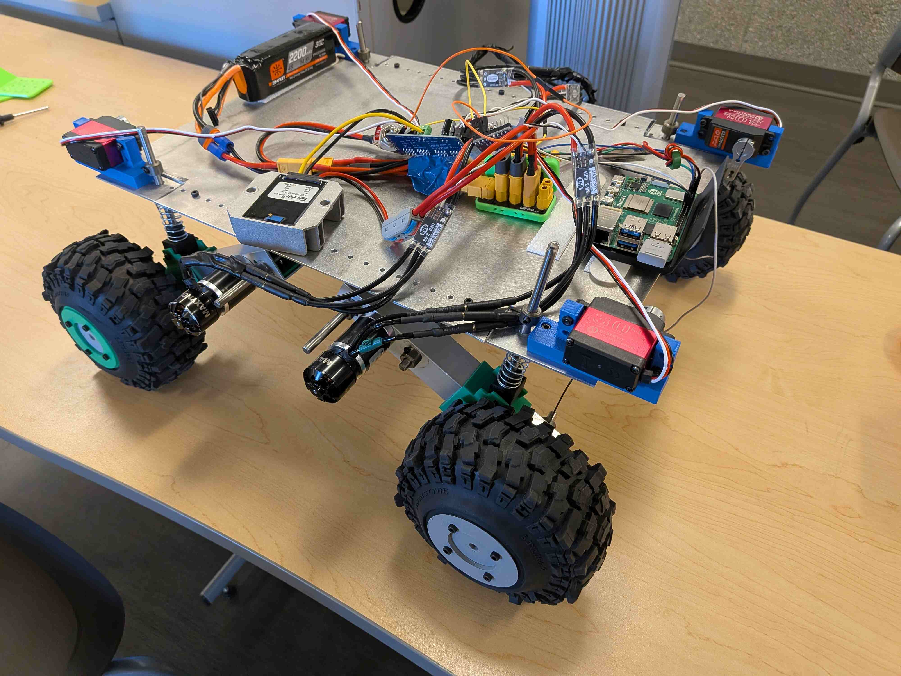

## 8/12 - THE FINAL DAY‼️‼️‼️‼️‼️‼️ - 7 hours
ladies, gentlemen, and my beautiful enbies ***ITS TIME!!!!!!!!!!!!!!!!!!!!!!!!!!!!!!!!!!!!!!!!!!!!!!!!!!!!!!!!!!!!!!!!!!!!!!!!!!!!!**
*(ok so i admit this entry was written days later cause i had to go to school next day so my memory is foggy but! its still cool :3)
basically the first half of the day (before everyone came in) was spent finalizing somethings we'd waved off earlier, like
- cable management and wiring in general, especially the motor wires were dangerously close to the suspension rods and a bunch of other things like that
- power and attaching the battery, since we really needed to keep the batteries charged properly to prevent the pi being underpowered and the battery needed to be held on with something a little less flimsy than straight up velcro 😭
- THE GOD DAMN SET SCREWS HOLY TUNA THESE THINGS WILL NOT STAY TIGHT NO MATTER WHAT **WE ARE NEVER GOING UP THAT HILL AGAIN ISTG** *(subtle foreshadowing)*
- keeping the kill switch always accessible from the top and attaching it with a little more than tape and prayers
- making sure the wheels are attached properly and wont jut out weirdly as it has in the past, throwing the driving off balance as it
- getting the climb to actually work which is lowk a lost cause but we ball
- praying theres something we can do about the intake situation 😭🙏
- among much more

of course, the time eventually came when people started arriving (like alfonso, shoutout my goat) including a whole lot of parents. we started by showing them our robots as we made some final tweaks, like making sure the pi wouldnt fall off of our beautiful, incredibly complex attachment scheme (velcro mounting strips) until it finally happened...

**COMPETITION START‼️**
so the way this ended up going is that each team alternated runs, usually getting progressively further (keyword \*usually\*...)
### Run 1: Team Big Fish (not us)
their first run didn't go too bad!! their ball intake was suprisingly functional (and by suprisingly i mean at all) (better than us tho) and they were almost able to get around the cones autonomously without hitting one! however, when it came to the washboard, it didnt really work out...
their bot very quickly got stuck on a pipe and was ill equipped to unstuck itself, ending the first run.

### Run 2: Team 10 (US!!!!!!!!‼️!!!!!)
also not too bad somehow!!!!!!!!!! of course there was no ball intake so we just drove over them, but we were able to slowly but surely get past the slalom with wide margins and very very slow turns in place. as for the washboard though, our run wasnt much better...
i took the robot off of the ramp at the start rather fast, making sure to turn up the throttle limit in the hopes it would get us over a few obstacles. spoiler alert: it didnt. we pretty quickly just crashed into a full cinder block, bending the sheet metal base and unsurprisingly making it hard to continue the run! but whatever it was not too bad for a first attempt

### Run 3: Team Big Fish
this one was probably their best! the ball intake was great, and they were able to carry them all through a perfect no-hit slalom! unfortunately, a similar fate to last time met them at the washboard. third times the charm hopefully...

### Run 4: Team 10
although the robot was slightly banged up now, it was still totally good to go! this slalom attempt was not nearly as graceful, and that certainly applies to the washboard too: i turned up the throttle limit more on the ramp and really just sent it, only to get stuck *on top* of that cinderblock instead of past it. fun stuff!

ok so from here on we just started placing the robots at different places trying to show what they could do if the washboard didnt always destroy their runs
### Exhibition 1: Team Big Fish and ***THE HILL***...
for our first exhibition, the other team set up the robot before the hill and took some stabs and speeding their way over it. in the end, none of the attempts made it, but i have video of the third one where they got so close that one of the wheels drove onto the other side of the hill and kept the robot there, until their driver let go of the throttle and let it down. it was super cool!!

### Exhibition 2: Team 10 and THE HOOK
finally it was time for my teammates magnum opus of the past two weeks to be revealed and truly tested, and that of course was THE CLIMB!!!! and by the climb i mean a big pink plastic hook on the end of a measuring tape roll taken out of its case that we lovingly call "the bomb" (because it WILL explode if not handled properly). like i said a while ago though, the climb didnt have enough force to pull up the robot, but thats fine! theres still partial points for hooking, so all this exhibition really was was the hook rising at an almost comedically slow pace, before i carefully drove the robot over to the bar (as to not fold over the tape from the velocity) and gingerly brought the hook down on it. and everybody clapped!

### Exhibition 3: Team Big Fish and THE DUNK
aka they used their shooter. it was super cool actually! they have a whole system with conveyor belt squeezing balls forward from above a slanted metal sheet, with flywheels at the end that can block balls for storage purposes until the gate is opened and the conveyor belts are forwarded to shoot them! it was suprisingly good and consistent, shooting from behind the second-to-last line. i wish we could do that...
its okay they dont have a climb so we're better

and that was pretty much it! this experience has been so incredibly helpful for my learning and for me in general, and it really was(😢) one of the most fun times of my life. i dont even think i could near catalogue how much fun i had and how many things i learned. i really cant put it into words. thank you lucas, carlos, jade, maanya, patrick, alfonso, and trina for making this what it was, and of course thank you big zrl for sponsoring my attendance.

if you're reviewing this project, i recommend looking at devlogs further down if you're missing context. the photos should hopefully help see the progression as well (if i can get those uploaded...)

i leave you with 3 photos: the state of the robot right before i turned it off for the last time, the absolute state of our whiteboard after we used for brainstorming, and a last minute photo of the hallway i knew i would never walk again.

happy hack clubbing!
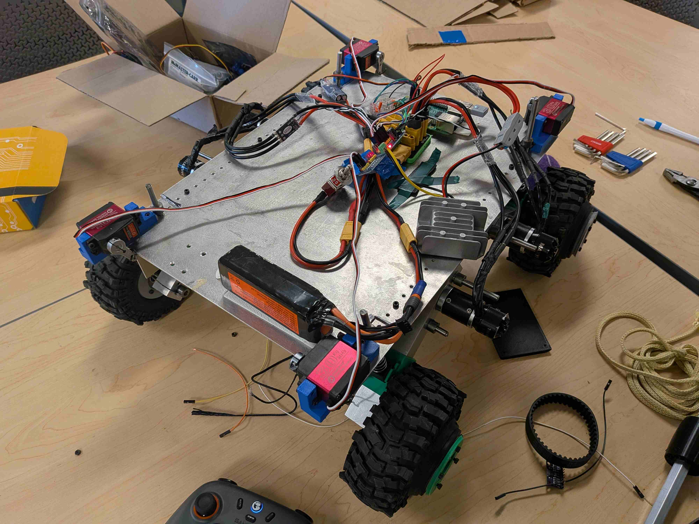
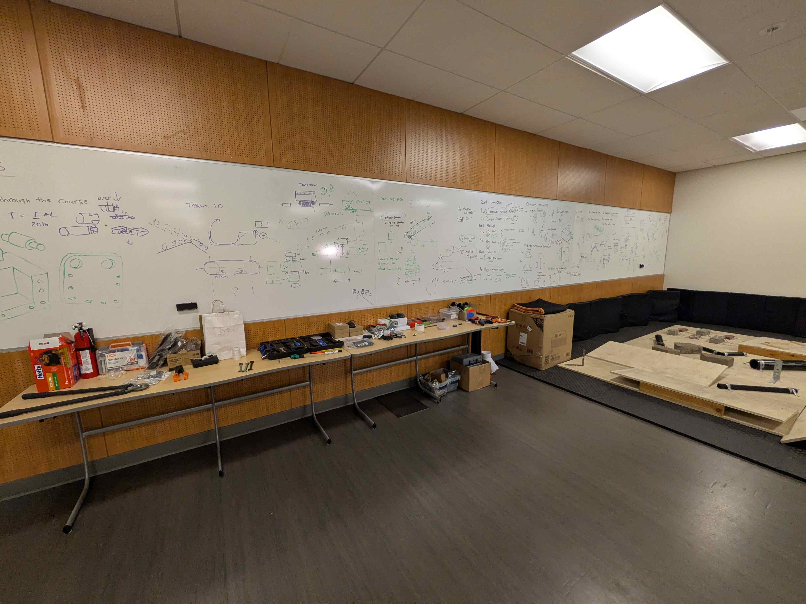
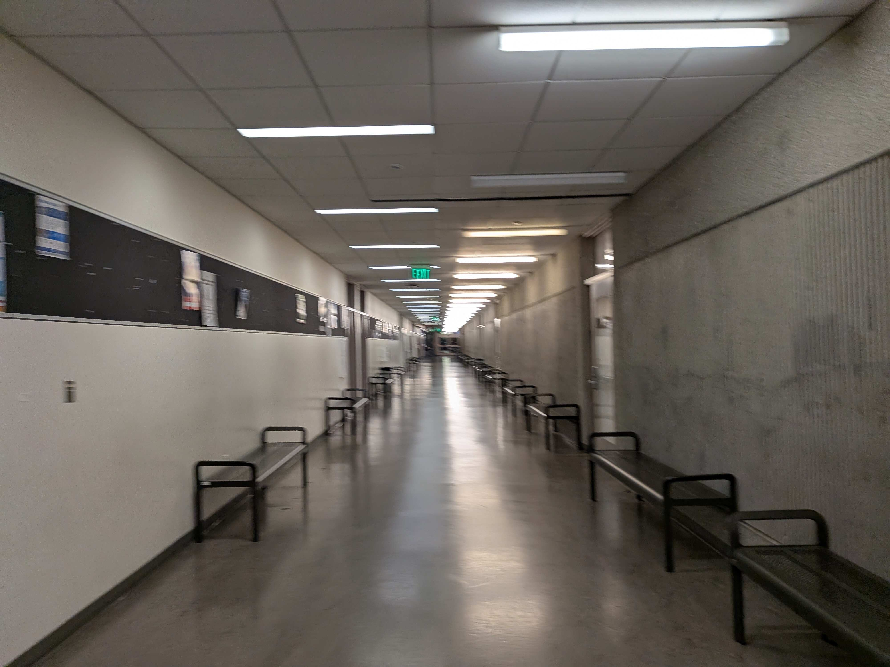

